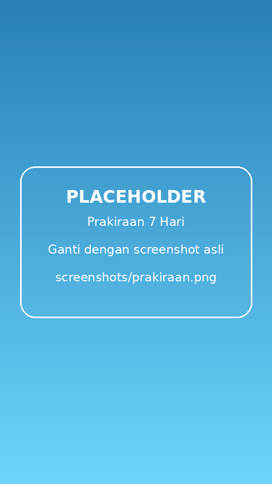
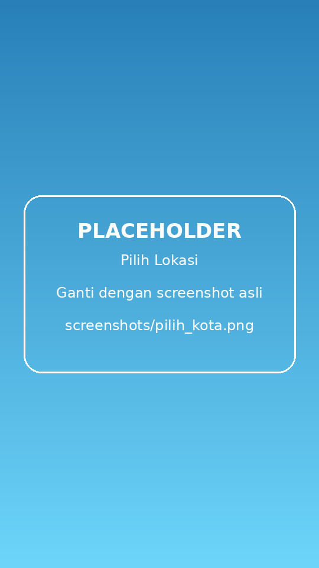
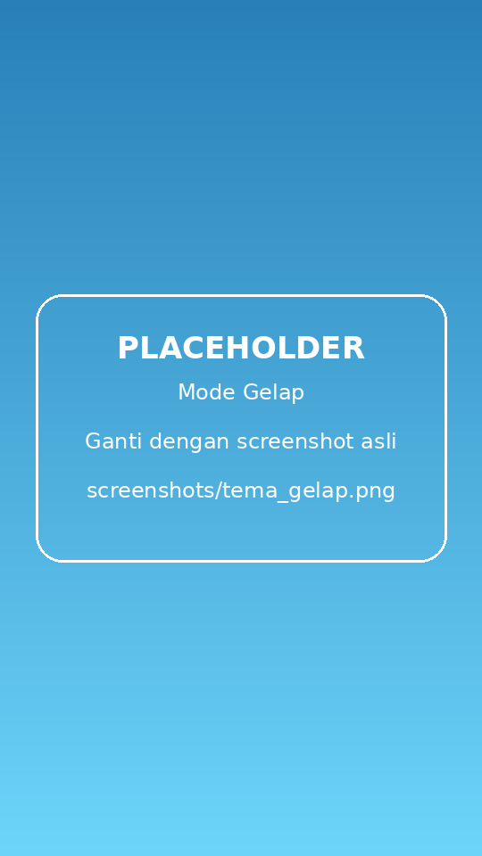

# 🌤️ Cuaca Kampus

## Nama Kelompok
Dewi Astuti - 2409106007
Intan Alfara Audia - 2409106008
Niluh Fincy Gloria N.M. - 2409106012
Angelina Augustin Umami - 2409106014
Ayu Azzahrah Alwi - 2409106022

## Nama Aplikasi / Judul Project

**Cuaca Kampus** — Aplikasi Prakiraan Cuaca Berbasis Lokasi (Flutter)

## Deskripsi Singkat Aplikasi

Cuaca Kampus adalah aplikasi mobile yang menampilkan kondisi cuaca saat ini dan prakiraan cuaca 7 hari ke depan. Aplikasi otomatis mendeteksi lokasi pengguna lewat GPS, lalu mengambil data cuaca dari API [Open-Meteo](https://open-meteo.com/) (gratis, tanpa API key). Jika GPS tidak aktif atau izin lokasi ditolak, pengguna tetap bisa memilih salah satu dari 14 kota besar di Indonesia secara manual.

### Fitur Utama

- 📍 **Deteksi lokasi otomatis** — memakai GPS dan mengubah koordinat menjadi nama kota (reverse geocoding).
- 🌡️ **Cuaca saat ini** — suhu, suhu terasa, kelembapan, kecepatan angin, dan kondisi cuaca (cerah, berawan, hujan, badai petir, dll).
- 📅 **Prakiraan 7 hari** — suhu maksimum/minimum dan peluang hujan per hari, dengan nama hari berbahasa Indonesia.
- 🏙️ **Pilih kota manual** — 14 kota: Jakarta, Bandung, Yogyakarta, Semarang, Surabaya, Denpasar, Balikpapan, Samarinda, Makassar, Manado, Medan, Palembang, Padang, dan Jayapura.
- 🌓 **Tema Terang / Gelap / Otomatis** — mode otomatis mengikuti jam (terang 06.00–18.00, gelap selebihnya).
- 🔄 **Tarik untuk memperbarui** (pull-to-refresh) dan penanda waktu pembaruan terakhir.
- ⚠️ **Penanganan error** — tampilan khusus saat tidak ada koneksi internet, lengkap dengan tombol *Coba lagi*.
- 🪟 **Antarmuka glassmorphism** dengan latar gradien yang berubah sesuai tema dan kondisi cuaca.

## Screenshot

| Beranda | Prakiraan 7 Hari |
|:---:|:---:|
|  |  |

| Pilih Lokasi | Mode Gelap |
|:---:|:---:|
|  |  |


## Teknologi yang Digunakan

| Komponen | Keterangan |
|---|---|
| Framework | Flutter (Dart) dengan Material 3 |
| API cuaca | [Open-Meteo Forecast API](https://open-meteo.com/en/docs) |
| `http` | Memanggil REST API |
| `geolocator` | Mengambil koordinat GPS dan mengelola izin lokasi |
| `geocoding` | Mengubah koordinat menjadi nama kota |
| `intl` | Format tanggal/jam dalam bahasa Indonesia |

## Cara Menjalankan Project

### 1. Prasyarat

- [Flutter SDK](https://docs.flutter.dev/get-started/install) (stable) — cek dengan `flutter --version`
- Android Studio / VS Code dengan plugin Flutter & Dart
- Emulator Android atau perangkat fisik (GPS & izin lokasi bekerja paling baik di perangkat nyata)
- Koneksi internet

### 2. Langkah-langkah

```bash
# 1. Ekstrak / clone project, lalu masuk ke foldernya
cd cuaca_tugaspbb

# 2. Unduh semua dependency
flutter pub get

# 3. Pastikan perangkat/emulator terdeteksi
flutter devices

# 4. Jalankan aplikasi
flutter run
```

### 3. Perintah tambahan

```bash
flutter test                 # menjalankan widget test
flutter analyze              # mengecek kode
flutter build apk --release  # membuat APK rilis
```

### 4. Catatan Penting

- **Izin lokasi:** saat pertama dibuka, aplikasi meminta izin lokasi. Jika ditolak atau GPS mati, aplikasi menampilkan cuaca **Jakarta** dan pengguna dapat memilih kota lewat ikon ☰ di pojok kanan atas.
- **Emulator Android:** atur lokasi lewat *Extended controls (⋮) → Location*, atau cukup pilih kota secara manual.
- **`android/local.properties`** berisi path SDK di komputer pembuat. Android Studio akan membuat ulang file ini otomatis. Jika muncul error `flutter.sdk not set`, jalankan `flutter pub get` atau buka project via Android Studio.

## Struktur Project

```
cuaca_tugaspbb/
├── lib/
│   └── main.dart          # Seluruh kode aplikasi (UI, logika lokasi, pemanggilan API)
├── test/
│   └── widget_test.dart   # Widget test dasar
├── screenshots/           # Gambar untuk README
├── android/ ios/ web/ ...  # Konfigurasi platform
└── pubspec.yaml           # Dependency & metadata
```

## Alur Kerja Aplikasi

1. Aplikasi dibuka → meminta izin lokasi & membaca koordinat GPS.
2. Koordinat diubah menjadi nama kota (jika gagal, tampil "Lokasi Anda").
3. Aplikasi memanggil Open-Meteo dengan koordinat tersebut.
4. Respons JSON diolah menjadi kartu cuaca saat ini dan daftar prakiraan 7 hari.
5. Jika terjadi kegagalan jaringan, tampil layar error dengan tombol *Coba lagi*.


## Sumber Data

Data cuaca disediakan oleh [Open-Meteo.com](https://open-meteo.com/) (lisensi CC BY 4.0, gratis untuk penggunaan non-komersial).

